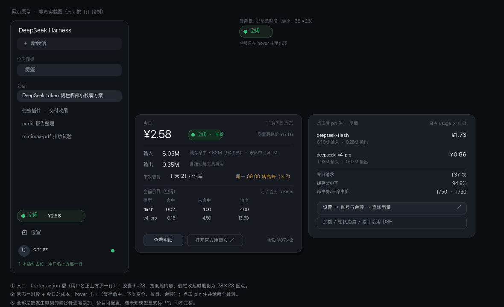

# dsh-token-pill

侧边栏底部的一枚 DeepSeek 花费胶囊：常态显示**当前峰谷时段 + 今日总花费**，悬停展开（点击钉住）明细——缓存命中、按模型拆分、当前价目、下次变价时间与余额。



## 它怎么算钱

- **数据来源**：本机 Session 事件流里每条 `assistant/message` 自带的 `usage`，按事件发生的**那一刻**套用当刻的 DeepSeek 价目（高峰全价、空闲半价）。
- **缓存命中单独计价**：`inputTokens` 是未命中输入，`cacheReadTokens` 是命中，两者价差 30–50 倍；`cacheWriteTokens` 计入未命中。
- **模型取自消息本身**（`message.source.model`），拿不到时回落到该请求的 `request/header`。价表里没有的模型**只统计 token、不计价**，并在卡片里点名，绝不套用邻近模型的价格。
- **价目（元 / 百万 tokens，高峰价）**：

  | 模型 | 缓存命中 | 未命中输入 | 输出 |
  | --- | --- | --- | --- |
  | `deepseek-flash` | 0.04 | 2 | 8 |
  | `deepseek-v4-pro` | 0.30 | 9 | 27 |

  空闲时段 = 高峰价 × 0.5。来源：[DeepSeek 定价页](https://api-docs.deepseek.com/zh-cn/quick_start/pricing)（2026-11 核对）。

## 架构

宿主侧注册一个 Session 投影 `tokenPill`，把每次响应按「本地日期 + 当刻峰谷」累加成一个按天账本；宿主再把它汇总成一份跨会话的今日账本，通过同源路由 `GET /dsh-token-pill/usage` 交给客户端。客户端只负责显示，不读 RPC、不扫事件。

- **为什么汇总在宿主做**：`session/list` 只给「活跃会话」实时折叠投影；冷会话那一列来自磁盘投影缓存，而缓存行要等某次冷读折叠过才有。新装的投影对旧会话没有缓存行，列表里就会静默漏掉它们的花费（社区同类插件正是在这里少算）。宿主改用 `sessionQuery.observeSession()` 逐个折叠——冷安全、首次读即落缓存。
- 不做转写回放：不翻页、不扫事件、没有历史长度上限。
- 价目只存在 `host/pricing.js` 一处，随响应下发；客户端零价格知识。
- 宿主只读本地事件，不联网、不外发；汇总结果在宿主内存里缓存 15 秒。

```
index.js              注册投影、暴露聚合路由
host/pricing.js       价目、峰谷规则、usage → 成本
host/projection.js    按天账本 + 折叠逻辑 + 下发给客户端的视图
host/usage.js         跨会话聚合（observeSession 冷安全读 + 15s 缓存）
client.js             胶囊、悬停卡、明细、余额
locale/*.json         槽位标题（多语言）
scripts/verify.mjs    离线自检（node scripts/verify.mjs）
```

## 安装

```bash
# 在 DSH 里（插件面板或 plugin_manager）把本目录作为 bundle 安装：
plugin_manager({ action: 'install_bundle', target: '<绝对路径>/dsh-token-pill' })
```

装好后刷新页面，胶囊出现在侧边栏底部、用户名上方一行；侧边栏收起时退化为一个圆点。

## 已知局限

- **节假日不建模**：DeepSeek 把法定节假日按空闲计费，但那份日历每年都变，写死一张错的表比留缺口更糟。遇到节假日，本插件的高峰时段读数会偏高（正是社区同类插件 `dsh-board` 的已知 bug）。
- **金额是本机估算**：官方页面（设置 → 账号与余额 → 查询用量）是控制台 webview，页面数据不回流 JS，DSH 也没有账单接口。实测差约 0.4%（逐笔四舍五入、读数时间差、`reasoningTokens` 口径），以官方账单为准。
- **只看本机会话**：多设备/多客户端的用量不在其中。
- **投影只保留最近 7 天**：胶囊只读今天，历史留给官方用量页。
- **首次读取稍慢**：冷会话第一次折叠要把日志读一遍（十几毫秒级），之后走缓存；聚合结果在内存里缓存 15 秒。

## 自检

```bash
node scripts/verify.mjs
```

离线跑，不需要宿主、浏览器或网络：覆盖槽位契约、双语字典键集、峰谷判定、价目换算、宿主账本折叠、跨会话聚合（含读不到的会话仍计为未就绪）、客户端读取与渲染兜底。

## License

MIT
